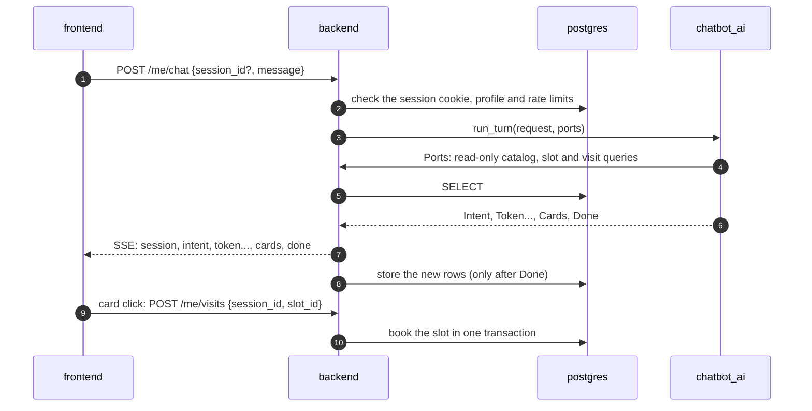

# backend

The FastAPI app. It owns auth, the Postgres schema, every write, the chat stream and the KB ingestion job. It calls the `chatbot_ai` package in-process. Contracts: [`docs/spec/api.md`](../docs/spec/api.md), schema: [`docs/spec/schema.dbml`](../docs/spec/schema.dbml).

## How a chat turn works



- The acting user always comes from the `session_id` cookie, never from the body or the model.
- The model never writes. Bookings, cancellations and complaints are endpoints that the user's card clicks call.
- KB uploads stream to disk, are de-duplicated by hash, then ingested one at a time in a child process (`kb_jobs.py`).
- `metrics.py` exposes Prometheus metrics at `/metrics`, including the per-stage timings that `chatbot_ai` returns.

## Layout

| Path | Contents |
|---|---|
| `app.py` | `create_app()`: settings, engine, KB runner, middleware, routers |
| `routes/` | `auth`, `me` (profile, sessions), `chat`, `visits`, `complaints`, `locations`, and `admin/` |
| `ai_ports.py` | Postgres implementations of the `chatbot_ai` Ports |
| `models.py`, `alembic/` | SQLAlchemy models and migrations |
| `auth.py`, `deps.py`, `ownership.py` | sessions, argon2, mode and ownership checks |
| `rate_limit.py` | in-memory abuse counters |
| `kb_jobs.py` | background ingestion runner |

## Sample

This sample logs in as the seeded member `user1` and streams one chat turn. It needs the backend running on port 8000, with the seed data loaded (see the root README). The session cookie is marked `Secure`, so over plain HTTP the sample sends it by hand:

```python
import json

import httpx

with httpx.Client(base_url="http://localhost:8000", timeout=60) as client:
    login = client.post("/auth/login", json={"username": "user1", "password": "userpass1"})
    login.raise_for_status()
    client.headers["Cookie"] = f"session_id={login.cookies['session_id']}"

    print(client.get("/auth/me").json())

    with client.stream("POST", "/me/chat", json={"message": "I need a dermatologist"}) as stream:
        event = "message"
        for line in stream.iter_lines():
            if line.startswith("event:"):
                event = line.removeprefix("event:").strip()
            elif line.startswith("data:"):
                print(event, json.loads(line.removeprefix("data:")))
```

Output shape:

```text
{'username': 'user1', 'role': 'user', 'has_profile': True, 'mode': 'user'}
session {'session_id': 12}
intent {'intent': 'visit.book'}
token {'text': 'Here are '}
...
cards {'type': 'doctors', 'items': [{'slot_id': 431, 'doctor_name': '...', ...}]}
done {}
```

To book one of the cards, call `POST /me/visits` with `{"session_id": 12, "slot_id": 431}`.

## Commands

```bash
uv run alembic -c backend/alembic.ini upgrade head      # migrate
uv run uvicorn backend.app:app --reload                 # run on :8000
uv run pytest backend/tests                             # tests (real Postgres and Qdrant, fake models)
```
