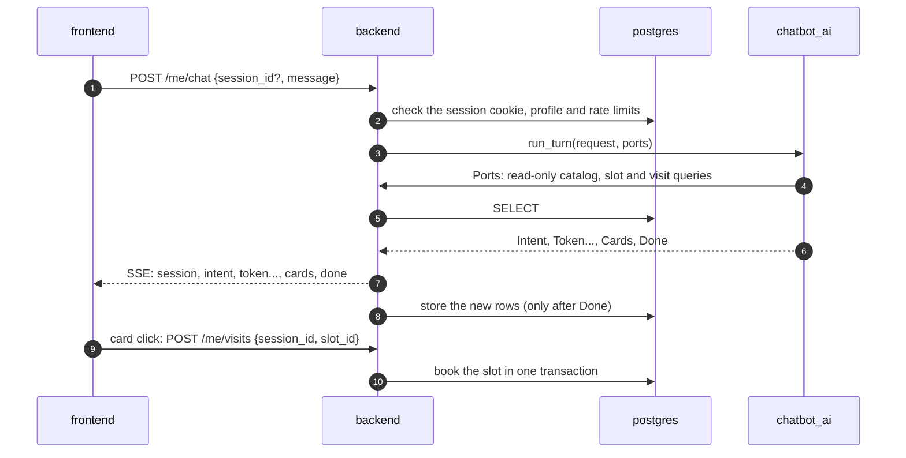

# backend

The FastAPI app. It owns:

- auth (sessions, passwords, roles),
- the Postgres schema,
- every write to the database,
- the chat stream,
- the KB ingestion job.

It calls the `chatbot_ai` package in-process; there is no separate AI service.

The contracts are in [`docs/spec/api.md`](../docs/spec/api.md) and the schema is in [`docs/spec/schema.dbml`](../docs/spec/schema.dbml). For setup and configuration, see the [root README](../README.md).

## How a chat turn works



The same turn in words:

1. The frontend posts the message to `/me/chat`. The `session_id` in the body is optional; it is left out for a new chat.
2. The backend checks the session cookie, the member's profile and the rate limits.
3. It calls `run_turn` in `chatbot_ai`, passing the **Ports**: objects the AI uses to read the catalog, slots and visits. The backend implements them with read-only queries.
4. The AI yields events. The backend forwards them to the browser as Server-Sent Events.
5. Only after the final `Done` event does the backend store the new chat rows.
6. If the member clicks a card (for example **Book**), the frontend calls a normal endpoint, and the backend does the write in one transaction.

## Rules the backend enforces

- **The acting user comes from the session.** It is read from the `session_id` cookie, never from the request body or the model.
- **The model never writes.** Bookings, cancellations and complaints are endpoints, called only by the user's card clicks.
- **KB uploads are handled safely.** Each upload is streamed to disk and de-duplicated by its hash. Then the documents are ingested one at a time, in a child process (`kb_jobs.py`).
- **Metrics are private.** `metrics.py` exposes Prometheus metrics at `/metrics`, including the per-stage timings that `chatbot_ai` returns. `/metrics` is not reachable through the public proxies.

## Layout

| Path | Contents |
|---|---|
| `app.py` | `create_app()`: settings, engine, KB runner, middleware, routers |
| `routes/` | `auth`, `me` (profile, sessions), `chat`, `visits`, `complaints`, `locations`, and `admin/` |
| `ai_ports.py` | the Postgres implementations of the `chatbot_ai` Ports |
| `models.py`, `alembic/` | SQLAlchemy models and migrations |
| `auth.py`, `deps.py`, `ownership.py` | sessions, argon2, mode and ownership checks |
| `rate_limit.py` | in-memory abuse counters |
| `kb_jobs.py` | the background ingestion runner |

## Sample: log in and stream one turn

This sample logs in as the seeded member `user1` and streams one chat turn.

**Before you run it:**

- the backend must be running on port 8000,
- the seed data must be loaded (see the [root README](../README.md#step-3-create-an-admin-and-the-demo-data)).

**Why the cookie is set by hand:** the session cookie is marked `Secure`, so an HTTP client won't send it back over plain HTTP. The sample copies it into the `Cookie` header itself.

```python
import json

import httpx

with httpx.Client(base_url="http://localhost:8000", timeout=60) as client:
    login = client.post("/auth/login", json={"username": "user1", "password": "userpass1"})
    login.raise_for_status()
    client.headers["Cookie"] = f"session_id={login.cookies['session_id']}"

    print(client.get("/auth/me").json())

    with client.stream("POST", "/me/chat", json={"message": "I need a dermatologist"}) as stream:
        event = "message"
        for line in stream.iter_lines():
            if line.startswith("event:"):
                event = line.removeprefix("event:").strip()
            elif line.startswith("data:"):
                print(event, json.loads(line.removeprefix("data:")))
```

Output shape:

```text
{'username': 'user1', 'role': 'user', 'has_profile': True, 'mode': 'user'}
session {'session_id': 12}
intent {'intent': 'visit.book'}
token {'text': 'Here are '}
...
cards {'type': 'doctors', 'items': [{'slot_id': 431, 'doctor_name': '...', ...}]}
done {}
```

**Next step:** to book one of the cards, call `POST /me/visits` with `{"session_id": 12, "slot_id": 431}`.

## Commands

Run these from the repo root.

```bash
uv run alembic -c backend/alembic.ini upgrade head      # apply the migrations
uv run uvicorn backend.app:app --reload                 # run the API on :8000
uv run pytest backend/tests                             # tests (real Postgres and Qdrant, fake models)
```
