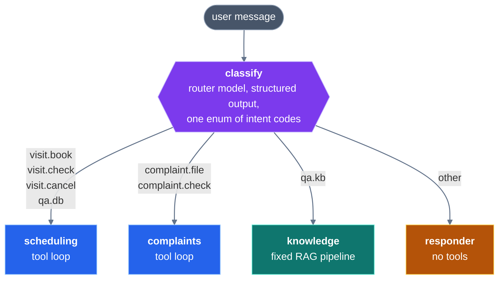

# Health Insurance Chatbot - AI Package Design

Version: v0.1.0

Companion to `rules.md` (AI rules are section I; other rules cited by ID), `schema.dbml`, `wireframes.md` and `api.md`. This file describes the `chatbot_ai` package: modules, interfaces, pipelines, provider config and the eval module. Behavior rules live in `rules.md` and are cited here, never restated.

The package lives in `packages/chatbot_ai/` and is deployed inside the backend image (same container, no separate AI service). It has no Postgres access, no web-framework code and no Prometheus code (H2); it calls the model providers and Qdrant directly. Langfuse instrumentation is allowed inside it (F7).

---

## 1. Public interface

The backend calls these four functions. Everything else is internal. `run_turn` lives in `orchestrator.py` and is exported from the package; the ingestion functions are in `chatbot_ai.ingest`, which also has async `delete_document_async` and `ensure_collection_once` for the API process.

```
async def run_turn(req: TurnRequest, ports: Ports, settings: AISettings,
                   clients: RoleClients | None = None,      # one per process, reused by the backend
                   agents: Mapping[AgentName, Agent] | None = None,  # tests inject a registry
                   clock: Clock = time.monotonic) -> AsyncIterator[TurnEvent]

def ingest(document_id: int, file_path: str, file_type: str, settings: AISettings) -> IngestResult
def delete_document(document_id: int, settings: AISettings) -> None
def ensure_collection(settings: AISettings) -> None      # at startup
```

TurnRequest:
- `history`: chat rows already trimmed by the backend (F4), in OpenAI message format (role, content, tool_calls, tool_call_id, tool_name).
- `message`: the new user message.
- `profile`: display name, location name and location id. The location id is catalog data the model needs to filter searches. Profile and account ids never reach the model (B6, I4).
- `needs_label`: bool. True when the session has no intent yet (F6).
- `session_id`: used for the Langfuse session id (F7).

Ports (Protocols the backend implements, in `tools/ports.py`): `Ports(scheduling, complaints, knowledge)` holds a `SchedulingPort`, a `ComplaintsPort` and a `KnowledgePort` (`ready_document_ids()`, G8). Each instance is built per request with the acting profile bound, so tool arguments never carry a profile id (B6, I4). Ports return Pydantic models from `tools/models.py` and never write (D9).

TurnEvent (what the backend turns into SSE events and metrics):
- `Intent(code)`: emitted only when `needs_label` is true and classification succeeded, before any token (F6). The backend stores it and sends the `intent` event.
- `Token(text, elapsed)`: elapsed seconds since the LLM call started.
- `Cards(type, items)`: emitted after the last token (F12).
- `Done(new_rows, timings, usage, agent)`: `agent` names the agent that answered (metrics by agent, H3). `new_rows` are all rows of the turn, including the new user message, to store in one transaction (F3). `timings` keys: classify, rewrite, embed, search, rerank, ttft, generate, total, plus a list of (tool name, seconds). `usage` has prompt and completion tokens (H2).

Failures raise exceptions; the backend maps them to the `error` event (F3). If the client disconnects the backend closes the generator: the LLM call is cancelled, no `Done` is produced and nothing is stored (F16).

IngestResult: `chunk_count`, `table_chunks`, `timings` (parse, chunk, embed, upsert). Raises on failure; the backend sets status 'failed' with the message (G5).

---

## 2. Orchestration

Router plus specialists, with handoff (I1 to I4).



- The classifier sees the last 6 history rows (trimmed to start at a user row, I1). The 6 are counted over all stored rows, tool rows included; tool rows and tool-call-only assistant rows are then left out of the router request, which carries only the conversation text, and its prompt says a short follow-up ("yes, the second one") continues the current task. Its result picks the agent every turn (I1). When `needs_label` is true the same result is also stored as the sidebar label (F6).
- The router is invisible: its calls are never stored. Only the chosen agent's rows are stored, so history looks like a single-agent history (I3).
- Tool loops run up to `AI_MAX_TOOL_ROUNDS` rounds. Tool results are size-capped (F4).
- Each agent has a system prompt in `prompts/<agent>.md`, built from shared blocks (persona, F5 re-fetch note, F8 no medical advice, F17 English, C8 UTC, profile name, location name and id, and a note that the history may contain tool calls the agent cannot make: use only the tools listed now and re-fetch anything that can change) plus agent-specific instructions.
- Knowledge is a fixed pipeline rather than a model-driven loop (section 3). Only the final answer streams.
- Framework: none. Plain Python with the OpenAI SDK: a dict from intent code to agent, and a small tool loop. No checkpointer (F10).

### Tools

Read tools return data. Propose tools return a card payload and a short text summary for the model (D9). Card shapes are in `api.md`.

| Agent | Tool | Kind | Notes |
|---|---|---|---|
| scheduling | list_locations, list_specialties | read | canonical names and ids; used to resolve "derm", "Cairo" |
| scheduling | search_clinics(location_id?, specialty_id?) | read | with their specialties |
| scheduling | search_doctors(clinic_id?, location_id?, specialty_id?) | read | |
| scheduling | get_availability(doctor_id, from_date?, to_date?) | propose | only 'available' future slots (C7). Returns up to 3 `doctors` cards (earliest first in the window) and lists up to 10 slots as text for the model |
| scheduling | my_visits(status?) | read | the acting profile only |
| scheduling | recommend_doctors(specialty_id, location_id?) | propose | ranked per D5 (location defaults to the profile's), 3 items, `doctors` card |
| scheduling | propose_cancel(visit_id?) | propose | `cancel_confirm` cards: that visit if an id is given, otherwise all the user's scheduled visits (D8) |
| complaints | my_complaints() | read | status and admin replies |
| complaints | eligible_visits() | propose | completed visits without a complaint, `visits_for_complaint` card (E1, E2) |

Booking only happens through cards (D6), so every tool that offers slots (`recommend_doctors`, `get_availability`) emits `doctors` cards.

Database questions (qa.db) use only these typed tools (I5). Specialty and location ids are validated against the catalog by the port.

---

## 3. Knowledge pipeline (qa.kb)

Order is fixed (I6). Every optional stage has a config switch (I13).

1. **Rewrite.** One structured-output call (rewrite model) returns `{standalone, alternates}`. `standalone` is the question made self-contained from history. `alternates` has `AI_QUERY_COUNT - 1` paraphrases (default count 3). With count 1 no alternates are requested. On failure, use the raw message.
2. **Embed.** All queries in one embedding call. Dense vectors come from the embedding provider. Sparse BM25 vectors are computed in-process (fastembed), English only.
3. **Search.** One Qdrant hybrid query per query: dense and sparse prefetch (`AI_PREFETCH_K` each), fused server-side with RRF. `AI_RETRIEVAL_MODE` can force dense or sparse only (evals).
4. **Merge.** RRF across the per-query lists, keep the top `AI_FUSED_K` (default 30).
5. **Dedupe.** Drop repeats by point id, then by `content_hash` (I7).
6. **Rerank.** Reranker scores the candidates against the standalone question and keeps `AI_CONTEXT_K` (default 5). With provider `none` the fused order is kept.
7. **Grounding.** No candidates, or best score below `AI_RERANK_MIN_SCORE` (when set), returns the fixed reply without calling the chat model (I8). The threshold is calibrated per provider with the eval module, because score ranges differ between providers.
8. **Answer.** The chat model gets the excerpts, each labeled with its `headings` breadcrumb, and answers only from them (I8). No stored citations (removed from the schema); the answer may mention the section name in text.

Retrieval is recorded as a synthetic `search_kb(query)` tool call plus a tool result holding the excerpts, so history keeps one shape (I6, F3, F4).

Only 'ready' documents are searchable (G8). The ingest job upserts points only after every chunk is embedded, and deletes the document's points if it fails.

---

## 4. Ingestion

`ingest(document_id, file_path, file_type, settings)` reads the file from disk (G1, G11). It runs in a child process inside the backend container, one job at a time, killed on timeout (G5, I12), so parsing never blocks the API. The function is top-level and importable, builds its own clients from settings, and returns `IngestResult`. The parent sets statuses, records metrics from the returned timings (H2) and handles startup recovery (G7).

Steps:
1. **Parse.** pdf and docx go through Docling (layout and table aware). txt is read directly. No OCR in v1: a file with no extractable text fails with "No extractable text (scanned PDFs are not supported)". Docling model files are downloaded at image build time, not at runtime.
2. **Chunk.** Structure-aware, with a token budget `AI_CHUNK_MAX_TOKENS` (default 512).
   - Each chunk carries its heading breadcrumb ("Section > Subsection"). The embedded text is the breadcrumb plus the content.
   - Small paragraphs and list items under the same heading are merged up to the budget.
   - A table that fits the budget is one chunk, rendered as Markdown. A larger table is split by row groups with the header row repeated in every chunk. Table chunks have kind = 'table'.
3. **Embed** in batches of `AI_EMBED_BATCH` (default 64): dense vectors from the embedding provider, sparse BM25 vectors in-process.
4. **Upsert.** Point id is a UUIDv5 of (document_id, chunk_index). Before this, delete the document's existing points (G6). Payload: `document_id`, `chunk_index`, `content`, `headings` (list), `kind` (text | table), `content_hash` (SHA-256 of the whitespace-normalized, lowercased content). No page numbers.
5. If the job runs longer than `INGEST_TIMEOUT_S` (default 600), the parent kills the process and the job fails.

Collection name is derived from the embedding model and dimensions, for example `kb_<model>_<dim>`, so changing the embedding model creates a new collection. Re-index every document afterwards (G6). `ensure_collection` creates it with a dense vector of `AI_EMBEDDING_DIMENSIONS` and a sparse vector with the IDF modifier.

`delete_document(document_id)` deletes the points by filter on `document_id` (G9).

---

## 5. Providers and config

All model calls use the OpenAI API shape (I11). Closed-source OpenAI models are the primary target. Open-source servers (llama.cpp, vLLM and similar) are used only in small cases, such as query rewrite, by pointing that role's base URL at them.

- **API:** Chat Completions, not the Responses API. It is the shape other OpenAI-compatible servers implement, and it maps one to one to our chat rows (role, tool_calls, tool_call_id).
- **Features used:** streaming with usage reporting; tool calling; structured outputs (JSON schema, strict) for the classifier and the rewrite; the embeddings endpoint.
- **Client:** the OpenAI Python SDK with a retry limit and a timeout per role. Differences between providers (for example the name of the output-token parameter) are isolated in one client factory (`clients.py`).
- **Model names are config.** None is fixed in code or in this spec.

Roles (each has `AI_<ROLE>_BASE_URL`, `AI_<ROLE>_API_KEY`, `AI_<ROLE>_MODEL`; base URL defaults to OpenAI's, key falls back to `OPENAI_API_KEY`):

| Role | Used for |
|---|---|
| CHAT | tool loops and the final answers |
| ROUTER | the per-turn classifier (small, fast model) |
| REWRITE | query rewrite (small, fast model; the one role that may point at an open-source server) |
| EMBEDDING | document and query embeddings |
| RERANK | the reranker (see below) |
| JUDGE | evals only |

Embedder: `embed(texts, kind: "query" | "document")`. The `kind` selects optional prefixes (`AI_EMBEDDING_QUERY_PREFIX`, `AI_EMBEDDING_DOC_PREFIX`, empty for OpenAI models). `AI_EMBEDDING_DIMENSIONS` is required (collection creation needs it).

### Reranker (placeholder)

OpenAI has no rerank endpoint, so the reranker sits behind a Protocol and the target provider is not chosen yet.

```
class Reranker(Protocol):
    async def rerank(self, query: str, documents: list[str], top_n: int) -> list[RerankResult]

RerankResult = (index: int, score: float)       # index into documents, best first
```

Files under `rerank/`:
- `base.py`: the Protocol and `make_reranker(settings)`.
- `passthrough.py`: `PassthroughReranker` keeps the input order and returns score None. Used when `AI_RERANK_PROVIDER=none` and as the eval baseline.
- `target.py`: `TargetReranker`, a placeholder whose `rerank` raises `NotImplementedError("Reranker provider not chosen yet")`. Implement it once the provider is chosen. Contract: query, documents and top_n in; index and relevance score out. Use the RERANK role's base URL, key and model.

`AI_RERANK_PROVIDER` is `none` (default) or `target`. Until `target` is implemented the pipeline runs without reranking, and the grounding threshold is off (I8).

### Config reference

| Name | Default | Notes |
|---|---|---|
| AI_QUERY_COUNT | 3 | 1 to 5 (I13) |
| AI_RETRIEVAL_MODE | hybrid | hybrid, dense or sparse |
| AI_PREFETCH_K | 20 | per vector type, per query |
| AI_FUSED_K | 30 | candidates sent to the reranker |
| AI_CONTEXT_K | 5 | excerpts sent to the chat model |
| AI_RERANK_PROVIDER | none | none or target |
| AI_RERANK_MIN_SCORE | unset | unset disables the grounding threshold |
| AI_CHUNK_MAX_TOKENS | 512 | |
| AI_EMBED_BATCH | 64 | |
| AI_EMBEDDING_DIMENSIONS | required | |
| AI_EMBEDDING_QUERY_PREFIX, AI_EMBEDDING_DOC_PREFIX | empty | |
| AI_MAX_TOOL_ROUNDS | 4 | |
| AI_CHAT_MAX_OUTPUT_TOKENS | 800 | matches F15 |
| AI_ROUTER_MAX_OUTPUT_TOKENS | 512 | reasoning tokens count against the cap |
| AI_REWRITE_MAX_OUTPUT_TOKENS | 1024 | reasoning tokens count against the cap |
| AI_ROUTER_HISTORY_ROWS | 6 | the I1 window |
| AI_<ROLE>_OUTPUT_TOKEN_PARAM | max_completion_tokens | chat, router, rewrite, judge; or max_tokens |
| AI_<ROLE>_REASONING_EFFORT | unset | chat, router, rewrite, judge; omitted from requests when unset |
| AI_TIMEOUT_S | 60 | per request, every role |
| AI_MAX_RETRIES | 2 | every role |
| INGEST_TIMEOUT_S | 600 | |
| QDRANT_URL | required | |
| AI_QDRANT_COLLECTION | unset | overrides the derived collection name; the eval runs set it |
| LANGFUSE_PUBLIC_KEY, LANGFUSE_SECRET_KEY, LANGFUSE_HOST | unset | tracing is on when both keys are set |

Settings are one `AISettings` class (pydantic-settings) in the package. The backend builds it from the environment and passes it in.

---

## 6. Observability

The package returns timings as plain values (H2): per-token `elapsed`, and in `Done` the stage timings, tool durations and token usage listed in section 1. The backend turns them into Prometheus metrics (H3). Langfuse gets one trace per turn with a span per stage (classify, rewrite, embed, search, rerank, generate, each tool call), with the session id from F7. The turn span is the trace root (it ignores any ambient OpenTelemetry span, such as FastAPI's request span). Each span records its input and output, and generations also record token usage, so Langfuse can show cost. When the Langfuse keys are absent, tracing is off.

---

## 7. Eval module

Lives in `packages/chatbot_ai/src/chatbot_ai/evals/`. It is offline only. The runtime never evaluates its own answers (I9); the judge model here scores results after the fact.

```
evals/
  datasets/       routing.jsonl, retrieval.jsonl, answers.jsonl, tools.jsonl
  kb_fixtures/    small synthetic insurance documents (pdf and docx, with tables)
  reports/        generated, git-ignored
  catalog_ports.py  in-memory catalog ports (no Postgres)
  suites.py, routing.py, report.py, schemas.py
```

Reports of runs worth keeping are copied to `docs/evals/` (write-up per version in `docs/evals/v<version>.md`).

Run: `uv run python -m chatbot_ai.evals <suite|all> [--set KEY=VALUE ...] [--smoke] [--langfuse]`
- `--set` overrides config for one run (for example `AI_RETRIEVAL_MODE=dense`), which is how ablations work (I13).
- `--smoke` runs a handful of items per suite for a quick check.
- `--langfuse` also records scores to a Langfuse dataset run.
- Each run writes a Markdown and a JSON report with a snapshot of the config (roles, models, switches), the date and the numbers.

The runner uses its own Qdrant collection (created and dropped by the run) and fake ports built from fixtures. It needs no Postgres.

| Suite | Input | Checks |
|---|---|---|
| ingest | fixture documents | no empty chunks; breadcrumbs present; small tables stay whole; split tables repeat the header; expected table chunk counts. No LLM calls |
| routing | message, optional prior rows, expected intent code | accuracy, per-class recall, confusion matrix. Includes follow-ups, off-topic and mixed messages (I14), and the six starter-card messages |
| retrieval | question, `expected_phrases`, expected document | hit@k, recall@k and MRR (k = 5, 10) after each stage, plus latency per stage. Phrases rather than chunk ids, because chunk ids change when chunking changes |
| answers | question, `must_include` facts (each a phrase or a list of accepted wordings), `answerable` flag | judged by the JUDGE model: faithfulness to the retrieved excerpts, presence of the required facts, and correct refusal for unanswerable questions (I8) |
| tools | scripted scenario on fake ports, expected tool calls (name and argument subset) | right tools called, a card emitted when expected, no write is possible (D9). Includes multi-turn scenarios across agents (scheduling, then knowledge, then scheduling) that assert no tool outside the current agent's set is called and no stale slot data is repeated; the knowledge steps use the run's fixture collection |

Ablation table produced by the retrieval and answers suites:

| Run | Settings |
|---|---|
| A | AI_RETRIEVAL_MODE=dense, AI_QUERY_COUNT=1, no rerank |
| B | AI_RETRIEVAL_MODE=sparse, AI_QUERY_COUNT=1, no rerank |
| C | hybrid, AI_QUERY_COUNT=1, no rerank |
| D | C with the reranker (once `target` exists) |
| E | D with AI_QUERY_COUNT=3 |

Datasets are hand-reviewed. Claude Code may draft candidates from the fixtures; a human approves them. First targets: about 60 routing messages, about 40 questions (including unanswerable ones), about 10 tool scenarios. Evals cost money (JUDGE and every model role), so they are run on demand, not on every commit.

---

## 8. Package layout

```
packages/chatbot_ai/
  pyproject.toml
  src/chatbot_ai/
    settings.py          # AISettings
    clients.py           # OpenAI client factory per role, the Qdrant client and the tracer (RoleClients)
    interface.py         # TurnRequest, TurnEvent, Ports (re-exported Protocols)
    orchestrator.py      # run_turn: classify, route, handoff
    router.py, intents.py  # the classifier and the F6 intent codes
    context.py           # history rows to Chat Completions messages (F10)
    llm.py, prompts.py   # streaming calls and prompt assembly
    tracing.py           # Langfuse tracer, no-op without keys (F7)
    stub.py              # scripted turns used by the phase-5 tests
    agents/              # base.py, tool_loop.py (scheduling and complaints), knowledge.py, responder.py
    tools/               # registry.py (tool schemas), ports.py (Port Protocols), models.py (port return models)
    rag/                 # rewrite.py, search.py (embed, search, RRF merge, dedupe)
    rerank/              # base.py, passthrough.py, target.py (placeholder)
    ingest/              # api.py, parse.py, chunk.py, index.py
    prompts/             # one .md per agent plus shared blocks
    evals/
  tests/
```

---

## 9. Open items

- Reranker provider and the `TargetReranker` implementation, then the first `AI_RERANK_MIN_SCORE` (from evals) and ablation runs D and E.
- Larger eval datasets and harder KB fixtures: the approved v0.1.0 sets (routing 26, retrieval 16, answers 12, tools 7) are below the first targets in section 7 and too small to separate the retrieval configurations (`docs/evals/v0.1.0.md`).
- Decided (Gate 1, then 2026-11-18): model names per role and the embedding dimensions are in `.env.example` (chat, router and rewrite `gpt-6-luna`, embedding `text-embedding-3-small` at 1536, judge `gpt-6.2-sol`).
- Not in v1: a runtime answer self-check (I9) and a semantic cache (I10).
- Out of scope for v1: OCR for scanned PDFs, answering mixed-domain questions with more than one agent (I14).
