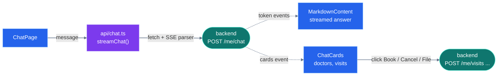

# frontend

The React app. It has four parts:

- login,
- onboarding (a new member sets up a profile),
- the chat, with action cards,
- the admin panel.

It is built with Vite, TypeScript, React Router, TanStack Query and Tailwind. In Docker, nginx serves it and proxies `/api` to the backend.

Every screen and its states are described in [`docs/spec/wireframes.md`](../docs/spec/wireframes.md). For setup, see the [root README](../README.md).

## How the chat works



The same flow in words:

1. `ChatPage` hands the member's message to `streamChat()` in `api/chat.ts`.
2. `streamChat()` posts it to the backend and reads the reply as a stream of events.
3. `token` events build up the answer, which `MarkdownContent` renders as it arrives.
4. A `cards` event shows doctors or visits in `ChatCards`.
5. Clicking **Book**, **Cancel** or **File** on a card calls a backend endpoint such as `POST /me/visits`.

Details worth knowing:

- **Why `fetch` and not `EventSource`:** the chat stream is a POST, and `EventSource` only does GET. So the stream is read with `fetch` and a small SSE parser (`createSseParser`).
- **Markdown is safe:** assistant text is rendered as Markdown without raw HTML.
- **Cards are the only way to write.** Each button calls a backend endpoint, and the chat rows it returns are added to the conversation.
- **Each role has a home page.** `GuardedRoute` sends:
  - admins to `/admin/kb`,
  - users without a profile to `/onboarding`,
  - everyone else to `/chat`.

## Layout

| Path | Contents |
|---|---|
| `src/api/` | typed fetch clients per area (`auth`, `chat`, `visits`, `admin`, `kb`) and `AuthContext` |
| `src/pages/` | one component per screen |
| `src/components/` | shared pieces (list below) |
| `src/components/chat/` | the chat sidebar, cards and Markdown renderer |
| `e2e/` | Playwright specs against mocked APIs |
| `e2e-stack/` | Playwright specs against the full Docker stack |
| `nginx.conf` | the nginx config, used in development and production (in production, Caddy adds HTTPS in front) |

What's in `src/components/`:

- the header, with the admin section menu (`AdminNav`; the sections are listed in `adminSections.tsx`),
- the theme switch,
- the dialog, and the shared confirm dialog (`useConfirm`),
- the visits drawer,
- icons.

## Sample: stream one turn

This sample streams one turn with the same typed client the chat page uses:

```ts
import { streamChat, type StreamEvent } from './api/chat';

const controller = new AbortController();
let answer = '';

await streamChat('I need a dermatologist', null, (event: StreamEvent) => {
  switch (event.event) {
    case 'session':
      console.log('session', event.session_id);
      break;
    case 'token':
      answer += event.text;
      break;
    case 'cards':
      console.log(event.cards.type, event.cards.items.length);
      break;
    case 'error':
      console.error(event.code, event.message);
      break;
  }
}, controller.signal);

console.log(answer);
```

The second argument, `null`, is the session id: `null` starts a new chat.

**Stopping a reply:** call `controller.abort()`. The backend then cancels the model call and stores nothing.

## Commands

Run these from `frontend/`.

```bash
npm ci
npm run dev          # http://localhost:5173, proxies /api to http://localhost:8000
npm run lint         # oxlint
npm run typecheck    # tsc
npm test             # Vitest
npx playwright test e2e/chat.spec.ts e2e/kb.spec.ts e2e/admin.spec.ts
```

About the Playwright specs:

- The **mocked** specs (`e2e/`) start Vite on port 5199. Set `E2E_PORT` to change it.
- The **stack-backed** specs (`e2e-stack/`) need the full Docker stack and run with `make e2e` from the repo root.
