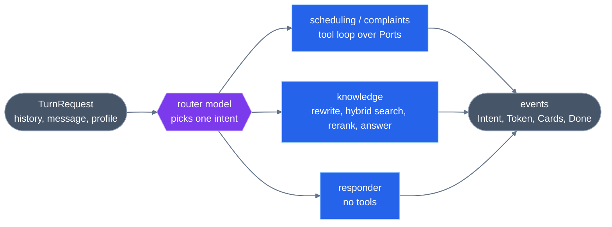

# chatbot_ai

The AI package: router, agents, RAG, KB ingestion and evals. It runs inside the backend process. It has no Postgres access and no web or Prometheus code. The backend gives it data through **Ports** and reads back plain events and timings. Full design: [`docs/spec/ai.md`](../../docs/spec/ai.md).

## How a turn works



- `run_turn(request, ports, settings)` is an async generator. It yields `Intent` (only when `needs_label` is set), `Token` while the answer streams, `Cards` when a tool found slots or visits, and finally `Done` with the rows to store, timings and token usage.
- The model only reads. Tools call the read-only `SchedulingPort`, `ComplaintsPort` and `KnowledgePort` that the backend implements. Bookings and complaints are written by endpoints when the user clicks a card.
- `ingest(document_id, file_path, file_type, settings)` parses a PDF, DOCX or TXT file with Docling, chunks it and writes dense and BM25 vectors to Qdrant. `delete_document` removes them.
- Each model role (chat, router, rewrite, embedding, judge) has its own `AI_<ROLE>_*` settings in `AISettings`.

## Layout

| Path | Contents |
|---|---|
| `interface.py` | `TurnRequest`, the event types, `Ports` |
| `orchestrator.py`, `router.py` | classify the turn and pick one agent |
| `agents/` | tool loop, knowledge pipeline, responder |
| `tools/` | tool schemas, Port Protocols, return models |
| `rag/`, `rerank/` | query rewrite, hybrid search, reranker Protocol |
| `ingest/` | parse, chunk, index |
| `prompts/` | one Markdown prompt per agent plus shared blocks |
| `evals/` | offline suites that call real models |
| `stub.py` | canned turns for tests and demos, no models needed |

## Sample

This sample streams one turn through the stub runner, which takes the same `TurnRequest` and yields the same events as `run_turn`. It needs no API key, Postgres or Qdrant:

```python
import asyncio

from chatbot_ai import Cards, Done, Intent, ProfileInfo, Token, TurnRequest, run_stub_turn


async def main() -> None:
    request = TurnRequest(
        history=[],
        message="I want to book a dermatologist",
        profile=ProfileInfo(display_name="Sara", location_name="Cairo", location_id=1),
        needs_label=True,
        session_id=1,
    )
    async for event in run_stub_turn(request):
        match event:
            case Intent(code=code):
                print(f"[intent] {code}")
            case Token(text=text):
                print(text, end="", flush=True)
            case Cards(type=card_type, items=items):
                print(f"\n[cards] {card_type}: {len(items)} item(s)")
            case Done(new_rows=rows, timings=timings):
                print(f"[done] {len(rows)} new row(s), total {timings.total:.3f}s")


asyncio.run(main())
```

Output:

```text
[intent] visit.book
Here are the available options for you.
[cards] doctors: 1 item(s)
[done] 4 new row(s), total 0.000s
```

To call the real models, set the `AI_*` variables in `.env` and swap in `run_turn(request, ports, AISettings())`. `ports` is a `Ports(scheduling=..., complaints=..., knowledge=...)` whose members implement the Protocols in `tools/ports.py`. The backend builds them in `backend/ai_ports.py`.

## Commands

```bash
uv run pytest packages/chatbot_ai/tests                 # unit and integration tests (fake models, real Qdrant)
uv run python -m chatbot_ai.evals routing --smoke       # real models, costs money
```
